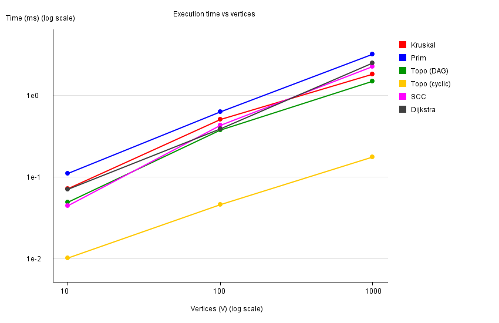
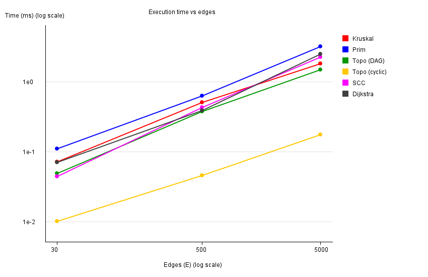
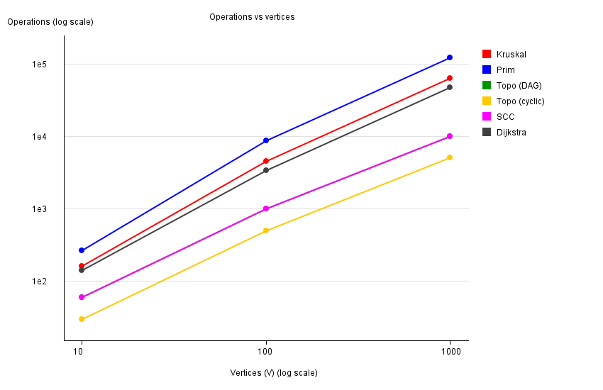

# Assignment 3 — Smart City Infrastructure and Route Planning

## Overview

This project models a smart city as a graph and solves three planning problems on it:

| Task | What it answers | Algorithms |
|---|---|---|
| 1. Infrastructure planning | Cheapest road network that connects all districts | Kruskal (with DSU), Prim (with priority queue) |
| 2. Connectivity | Build order of services, groups of mutually reachable districts | Topological sort (Kahn), SCC (Kosaraju) |
| 3. Route planning | Shortest routes from one district to all others | Dijkstra |

In the graph, **vertices** are districts (or infrastructure services), **edges** are roads or dependencies, and **weights** are construction costs or travel distances.

**Graph representation.** The `Graph` class keeps an adjacency list (`List<List<Edge>>`) and, in addition, one flat list of all edges. The adjacency list is used by Prim, Dijkstra, topological sort and the first DFS of SCC. The flat list is used by Kruskal (it needs to sort all edges) and to build the reversed graph for SCC. An undirected edge is stored once in the flat list and twice in the adjacency list (once per direction). Only the JDK is used, no external libraries. The plots are drawn with `java.awt` and `ImageIO`.

### Project structure

```
src/
├── graph/          Edge, Graph, GraphGenerator
├── dsu/            DSU
├── mst/            Kruskal, Prim, MSTResult
├── connectivity/   TopologicalSort, SCC
├── shortestpath/   Dijkstra
├── experiments/    Benchmark, PlotMaker
├── tests/          Tests
└── Main.java       demo of the city scenario
results/
├── tables/         results.csv, results.md, dsu.csv
└── plots/          time_vs_vertices.png, time_vs_edges.png, operations_vs_vertices.png
```

### How to run

```bash
javac -d out $(find src -name "*.java")
java -cp out Main                    # demo of the city scenario
java -cp out tests.Tests             # all correctness tests
java -cp out experiments.Benchmark   # experiments: writes tables and plots to results/
```

On Windows PowerShell the compile command is
`javac -d out (Get-ChildItem -Recurse src -Filter *.java).FullName`.
Run everything from the project root, because `results/` is created relative to it.
On a machine without a display add `-Djava.awt.headless=true` to the `java` command.

## Implementation

**DSU (`dsu/DSU.java`).** Two arrays, `parent` and `rank`. `find` is iterative: the first loop walks up to the root, the second loop (path compression) points every node on the path straight to the root. `union` finds both roots, returns `false` if they are equal, otherwise attaches the tree with the smaller rank under the other one. Both optimizations can be switched off with constructor flags. This is only used for the DSU experiment. The class also counts `find` calls, `union` calls and the number of parent pointers followed (`pathSteps`).

**Kruskal (`mst/Kruskal.java`).** Copies the edge list, sorts it by weight (the comparator counts comparisons), then goes through the edges and takes an edge when `union` succeeds. It stops as soon as `V − 1` edges are taken. If the graph is not connected, the result is a minimum spanning forest and `connected = false`. Connectivity is checked with `dsu.getComponents() == 1`.

**Prim (`mst/Prim.java`).** Lazy version with `PriorityQueue<Edge>`: all edges leaving a new vertex are pushed, the cheapest one is polled, and it is skipped if its endpoint is already in the tree. The outer loop starts from every unvisited vertex, so for a disconnected graph Prim also returns a forest and the number of started trees gives the `connected` flag. That makes it directly comparable with Kruskal.

**Topological sort (`connectivity/TopologicalSort.java`).** Kahn's algorithm: compute in-degrees, put vertices with in-degree 0 into a queue, repeatedly remove one and decrease the in-degree of its neighbours. If the final order has fewer than `V` vertices, the graph contains a cycle (`isDag = false`). `isValidOrder` is a separate checker that verifies every edge goes from an earlier to a later position, and is used in the tests.

**SCC (`connectivity/SCC.java`).** Kosaraju. DFS 1 records the finishing order; the reversed graph is built; DFS 2 runs on the reversed graph in decreasing finishing order, and every DFS tree of this second pass is one component. The DFS is recursive, which is fine for the sizes used here (up to 1000 vertices).

**Dijkstra (`shortestpath/Dijkstra.java`).** Binary heap (`PriorityQueue<long[]>` with `{distance, vertex}`) and lazy deletion: outdated queue entries are skipped. `dist[]` holds distances (`Long.MAX_VALUE` = unreachable), `prev[]` is used by `getPath` to restore the route; for an unreachable vertex the path is empty. Before starting, the algorithm checks all edges and throws `IllegalArgumentException` if a negative weight is found.

**Operation counters.**

| Algorithm | What is counted |
|---|---|
| Kruskal | comparisons in sort + edge examinations + DSU calls (`find` calls + `union` calls) |
| Prim | comparisons in the heap + edge examinations (edges looked at when a vertex is added) |
| Topological sort, SCC | edge examinations |
| Dijkstra | edge examinations + comparisons in the heap |

Note that `union` calls `find` twice internally, so one successful or failed union adds 3 to the Kruskal DSU counter (1 union call + 2 find calls).

## Complexity Analysis

Assumptions: `V` vertices, `E` edges, adjacency list, binary heap (`java.util.PriorityQueue`), and `E ≥ V − 1` for connected graphs.

| Algorithm | Time | Space |
|---|---|---|
| DSU `find` / `union` (both optimizations) | O(α(V)) amortized, practically constant | O(V) |
| Kruskal | O(E log E) = O(E log V) | O(V + E) |
| Prim (binary heap, lazy) | O(E log V) | O(V + E) |
| Topological sort (Kahn) | O(V + E) | O(V + E) |
| SCC (Kosaraju) | O(V + E) | O(V + E) |
| Dijkstra (binary heap) | O((V + E) log V) | O(V + E) |

**DSU.** Without any optimization a union can create a chain, so one `find` costs O(V). Union by rank keeps the height of every tree at most O(log V), so `find` is O(log V). Path compression flattens the tree on each `find`, so later `find`s on the same nodes are almost direct. With both, a sequence of `m` operations costs O(m · α(V)), where α is the inverse Ackermann function (at most 4–5 for any realistic input). Memory is two arrays of size `V`.

**Kruskal.** Sorting `E` edges is O(E log E). Since `E ≤ V²`, `log E ≤ 2 log V`, so this is O(E log V). The loop afterwards makes at most `E` union calls, O(E · α(V)), which is smaller than sorting, so sorting dominates. Space: the sorted copy of the edge list plus the DSU arrays.

**Prim.** Every undirected edge appears in two adjacency lists, so up to `2E` entries can be pushed into the heap. Each push and poll costs O(log E) = O(log V), which gives O(E log V). The heap holds up to O(E) entries (lazy version), so space is O(V + E). With a dense graph and an array instead of a heap it would be O(V²), but that variant is not implemented.

**Topological sort.** Each edge is looked at twice (once when counting in-degrees, once when its tail is removed from the queue) and each vertex enters the queue at most once: O(V + E). On a cyclic graph it stops earlier, because the vertices on and behind a cycle never reach in-degree 0.

**SCC.** Two DFS passes and building the reversed graph, each O(V + E). The recursion depth can reach O(V).

**Dijkstra.** Each successful relaxation adds one entry to the heap (at most `E` entries), and every heap operation costs O(log V) (more precisely O(log E), the same order). Total O((V + E) log V). For a connected graph this is O(E log V).

**Effect of V and E.** Kruskal, Prim and Dijkstra are driven mostly by `E` (times a log factor). Topological sort and SCC grow linearly with `V + E` and have no log factor. In dense graphs (`E` close to `V²`) the edge term dominates everything. In our test graphs `E = 3V` for the small graph and `E = 5V` for the medium and large ones, so `V` and `E` grow together.

### Why Dijkstra does not work with negative edges

Dijkstra is greedy. When a vertex is taken out of the queue with the smallest distance, its distance is treated as final. That is only safe if no later path can be shorter, and this holds only when edges cannot decrease the length of a path. Counter-example: `A→B (2)`, `A→C (5)`, `C→B (−4)`. Dijkstra takes `B` first with distance 2 and never goes back, but the real shortest path is `A→C→B` with length `5 − 4 = 1`. For this reason the implementation throws an exception when it sees a negative weight. For such graphs Bellman–Ford (O(V·E)) is the right choice. We use a simple Bellman–Ford in the tests as a reference for Dijkstra.

## Experimental Setup

**Graph sizes.**

| Graph | V | E |
|---|---|---|
| Small | 10 | 30 |
| Medium | 100 | 500 |
| Large | 1,000 | 5,000 |

**Generation.** `java.util.Random` with the fixed seed `42`, edge weights are random integers from 1 to 100, no self-loops and no duplicate edges. There are three generators in `GraphGenerator`:

- **Connected undirected graph** (Kruskal, Prim, Dijkstra). First a random tree is built: vertex `i` is connected to a random earlier vertex, so the graph is always connected. Then random extra edges are added until `E` is reached.
- **Directed acyclic graph** (topological sort on DAG). The vertices are shuffled to get a hidden order, and every random edge is directed from the earlier to the later vertex in that order, so a cycle is impossible.
- **Random directed graph with cycles** (topological sort on cyclic graph, SCC). Edges are fully random. The benchmark checks the result with topological sort. The generated graphs contain cycles in all three sizes (see below).

Properties of the generated directed graphs, checked by running the code:

| V | E | Random DAG is a DAG | Random directed graph is a DAG | SCC count | Largest SCC | Vertices output by Kahn on the cyclic graph |
|---|---|---|---|---|---|---|
| 10 | 30 | yes | no | 1 | 10 | 0 |
| 100 | 500 | yes | no | 1 | 100 | 0 |
| 1000 | 5000 | yes | no | 18 | 983 | 10 |

**Measurement.** Each experiment is run 3 times as a warm-up (so the JIT compiler has already compiled the code; these runs are not counted), then 5 times with timing by `System.nanoTime()` around one run. The result is the average of the 5 runs in milliseconds. Dijkstra always starts from vertex 0. The operation count is taken from the last run (it is the same in every run because the graph and the algorithm are deterministic).

**DSU experiment.** A separate test with 4 variants of DSU (naive, path compression only, union by rank only, both). For `n` = 10, 100, 1000, 10000 it does `n − 1` calls `union(k+1, k)` (this builds the worst-case chain for the naive version) followed by `n` calls of `find(0)`. We record the number of followed parent pointers (`path_steps`) and the average time of 5 runs.


## Results

### Algorithms on the three graph sizes

Source: `results/tables/results.md` and `results/tables/results.csv`.

| Algorithm | V | E | Avg time (ms) | Operations |
|---|---|---|---|---|
| Kruskal | 10 | 30 | 0.0721 | 163 |
| Prim | 10 | 30 | 0.1104 | 263 |
| Topo (DAG) | 10 | 30 | 0.0494 | 60 |
| Topo (cyclic) | 10 | 30 | 0.0103 | 30 |
| SCC | 10 | 30 | 0.0449 | 60 |
| Dijkstra | 10 | 30 | 0.0713 | 142 |
| Kruskal | 100 | 500 | 0.5042 | 4483 |
| Prim | 100 | 500 | 0.6316 | 8697 |
| Topo (DAG) | 100 | 500 | 0.3790 | 1000 |
| Topo (cyclic) | 100 | 500 | 0.0458 | 500 |
| SCC | 100 | 500 | 0.4295 | 1000 |
| Dijkstra | 100 | 500 | 0.3903 | 3403 |
| Kruskal | 1000 | 5000 | 1.8136 | 63793 |
| Prim | 1000 | 5000 | 3.1566 | 120958 |
| Topo (DAG) | 1000 | 5000 | 1.4741 | 10000 |
| Topo (cyclic) | 1000 | 5000 | 0.1746 | 5054 |
| SCC | 1000 | 5000 | 2.2337 | 10000 |
| Dijkstra | 1000 | 5000 | 2.4742 | 46698 |

MST weight (both algorithms give the same value): **129** for V=10, **1170** for V=100, **13123** for V=1000.

### DSU variants

Source: `results/tables/dsu.csv`. Chain of `n − 1` unions followed by `n` calls of `find(0)`.

| n | Variant | Path steps | Avg time (ms) |
|---|---|---|---|
| 10 | naive | 90 | 0.0262 |
| 10 | path compression | 18 | 0.0068 |
| 10 | union by rank | 17 | 0.0023 |
| 10 | both | 17 | 0.0019 |
| 100 | naive | 9,900 | 0.0625 |
| 100 | path compression | 198 | 0.0151 |
| 100 | union by rank | 197 | 0.0145 |
| 100 | both | 197 | 0.0154 |
| 1000 | naive | 999,000 | 2.2994 |
| 1000 | path compression | 1,998 | 0.1143 |
| 1000 | union by rank | 1,997 | 0.1245 |
| 1000 | both | 1,997 | 0.1151 |
| 10000 | naive | 99,990,000 | 192.4741 |
| 10000 | path compression | 19,998 | 0.1506 |
| 10000 | union by rank | 19,997 | 0.1342 |
| 10000 | both | 19,997 | 0.1478 |

### Plots

Both axes of every plot are logarithmic, otherwise the lines for V = 10 and V = 1000 would be squeezed together.







## Comparison and Discussion

**Kruskal vs Prim.** Both return the same MST weight on all three graphs (129, 1170, 13123), so they agree with each other. Kruskal was faster in every case: 0.072 vs 0.110 ms (V=10), 0.504 vs 0.632 ms (V=100) and 1.81 vs 3.16 ms (V=1000), so Prim was about 1.5×, 1.25× and 1.7× slower. Prim also does more counted operations: 263 vs 163, 8697 vs 4483, 120958 vs 63793 (about 1.6–1.9×). The reason is in the implementation. Prim looks at every edge from both ends (2E edge examinations) and pushes up to 2E entries into the heap, each with O(log E) cost. Kruskal sorts E edges once and stops after `V − 1` edges are accepted. DSU operations are very cheap thanks to both optimizations. Both are O(E log V), so the difference is a constant factor, not a different growth rate. The two algorithms count different things, so operation counts of Kruskal and Prim are only roughly comparable.

**DSU.** In the chain test the naive DSU needs `n(n − 1)` steps (99,990,000 for n = 10000) and 192 ms, which is quadratic growth. With path compression, union by rank, or both, the number of steps is about `2n` (19,997–19,998) and the time is about 0.13–0.15 ms, more than 1000× faster at n = 10000. Path compression alone and union by rank alone are equally good in this particular test, because this scenario does not separate them: with rank, the single new vertex is always hung under the existing root, so the tree stays flat. With compression, the first `find(0)` flattens the whole chain. The theoretical worst cases of the two are different (rank bounds the height by O(log V), compression gives the amortized bound), and together they give O(α(V)). The time differences between the three optimized variants (0.13–0.15 ms) are within measurement noise.

**SCC.** The time grew from 0.045 ms (V=10, E=30) to 0.430 ms (V=100, E=500) to 2.234 ms (V=1000, E=5000). The number of edge examinations is exactly `2E` for each size (60, 1000, 10000), which matches O(V + E) with two DFS passes. Time grew about 10× from the small to the medium graph (E grew 16.7×) and about 5× from the medium to the large graph (E grew 10×), so growth was not worse than linear. The small graph is too fast to measure precisely. The graph structure also differs: for V=10 and V=100 the whole graph is one strongly connected component, and for V=1000 there are 18 components, one of them with 983 vertices and the other 17 single vertices.

**Topological sort: DAG vs cyclic graph.** On the random DAG the algorithm outputs all vertices and makes exactly `2E` edge examinations (60, 1000, 10000). On the cyclic graphs it correctly reports that no order exists. It also finishes much faster (0.010 vs 0.049 ms, 0.046 vs 0.379 ms, 0.175 vs 1.474 ms), because it only counts in-degrees and then almost immediately runs out of vertices with in-degree 0. For V=10 and V=100 it outputs zero vertices (all vertices are on or behind a cycle), and for V=1000 it outputs only 10 vertices before getting stuck. That is why its operation count is `E` for the small and medium graphs and `E + 54` for the large one.

**Dijkstra.** Time grows from 0.071 ms to 0.390 ms to 2.474 ms, and operations from 142 to 3,403 to 46,698. The graphs are connected and undirected, so every vertex is reachable. Between V=100 and V=1000 the operations grow 13.7×, which fits `E log V` growth (E grew 10×, and the log factor adds a bit more). Dijkstra is in the same complexity class as Prim and Kruskal, and the measured times are close to them for large V (2.47 ms vs 3.16 ms for Prim and 1.81 ms for Kruskal). It is a bit slower than the linear algorithms (SCC, Kahn) at V=1000 because of the heap.

**Theory vs experiment.** Between the medium and the large graph `E` grows 10×. The measured operations follow the theory well: Kahn and SCC grow exactly 10× (`2E`), and Kruskal, Prim and Dijkstra grow 13.7–14.2×, which is about `10 × log` factor. The measured times grow less than the operations: Kruskal ×3.6, Topo (DAG) ×3.9, Prim ×5.0, SCC ×5.2, Dijkstra ×6.3. This is most likely a measurement effect: on graphs this small each run takes only about a millisecond or less, so fixed costs (JIT compilation state, object allocation, garbage collection, timer resolution) are a large part of the time, and the memory of a 5,000-edge graph fits easily in cache. We would need larger graphs to see the asymptotic behavior clearly. On the log–log plots all lines are roughly straight with a slope below or around 1, which is consistent with near-linear algorithms with a small log factor. Absolute times depend on the machine, but the operation counts are deterministic and can be reproduced exactly with the same seed.

## Testing

`java -cp out tests.Tests` runs 42 checks with a small custom test runner (no JUnit). Result: **42 passed, 0 failed**.

| Area | Test cases |
|---|---|
| DSU | initial component count, union merges, `find` equality after unions, separate element stays separate, repeated union returns `false`, component counter |
| MST | small graph, **disconnected graph** (spanning forest, `connected = false`), **multiple valid MSTs** (triangle with equal weights), **duplicate weights** (square, all weights 5), **single vertex**, and 30 random connected graphs (Kruskal weight equals Prim weight, both have `V − 1` edges) |
| Topological sort | DAG detected and the order is valid, **cycle detected**, single vertex, 30 random DAGs with order validation |
| SCC | known graph with components of size 3 and 2, every vertex is in exactly one component, DAG gives `V` components, single vertex, 30 random directed graphs (every vertex in exactly one component) |
| Dijkstra | known distances and paths, **unreachable vertex** (distance is infinity, empty path), negative weight rejected, single vertex, 30 random graphs compared against a reference Bellman–Ford |

`Main` also runs a small city example by hand: an MST over six districts (weight 19 for both algorithms), a build order of five services (`Power → Water → Internet → Roads → TrafficLights`), SCCs of a one-way road network (`{Center, East, North}`, `{South, West}`, `{Airport}`) and Dijkstra from the district South, where Center, North and East are correctly reported as unreachable.

## Conclusion

- **Minimum spanning tree.** Kruskal and Prim always returned the same weight. In our experiments Kruskal was faster (up to about 1.7× on the large graph) and does fewer operations, and it is simple to write when the graph is given as a list of edges. Prim is natural when the graph is stored as an adjacency list and gets better when the graph is dense (with an array instead of a heap). For sparse city road networks both are fine, and Kruskal was the better choice here.
- **DSU.** The optimizations are essential. On the chain test, the naive version needed about 10⁸ steps and 192 ms for n = 10000, and any optimized version needed about 2·10⁴ steps and 0.15 ms. This is why Kruskal's cycle check is almost free.
- **Topological sort** is the right tool for dependencies between services (build or construction order), and it also detects cycles, which means impossible dependencies. **SCC** finds groups of districts that can reach each other, for example clusters of one-way streets, and tells which parts of the network are not mutually reachable. Both run in O(V + E) and scale well.
- **Dijkstra** is the right choice for routing with non-negative distances or costs, with O((V + E) log V) time and path restoring through `prev[]`. It cannot be used when edge weights can be negative, and Bellman–Ford should be used in that case.
- **Limits of this study.** The graphs are random and relatively small, times are measured on a single machine, and for the cyclic directed graphs the structure (one huge SCC) is typical for random graphs and may differ from real city networks.